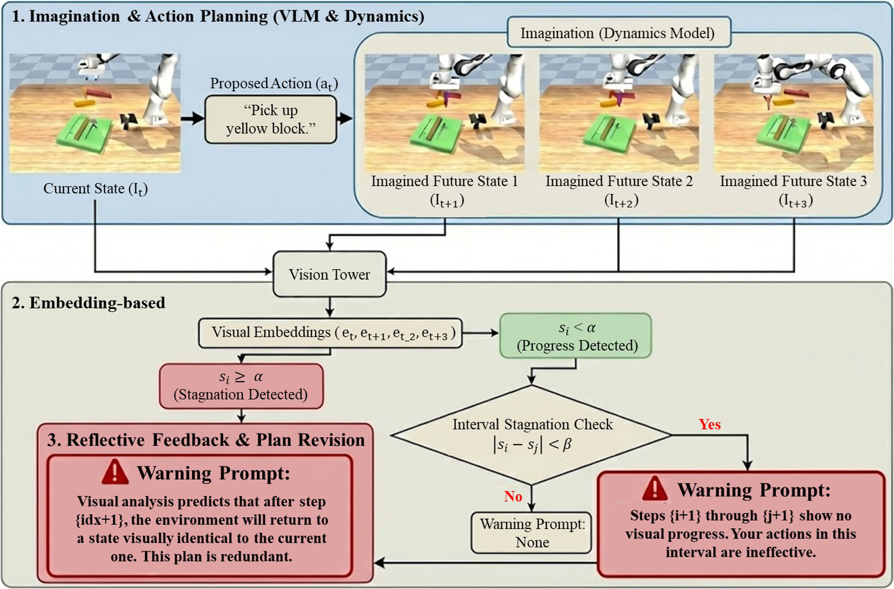
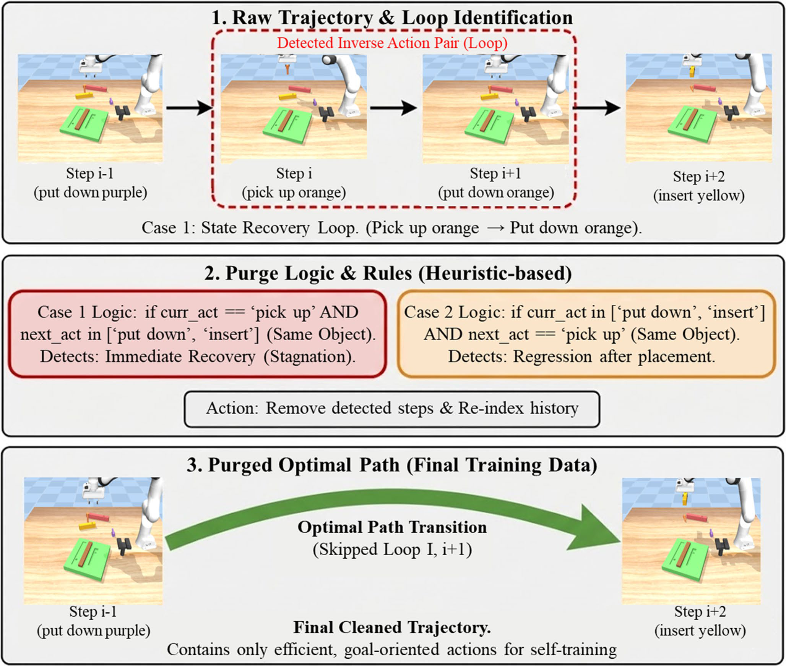
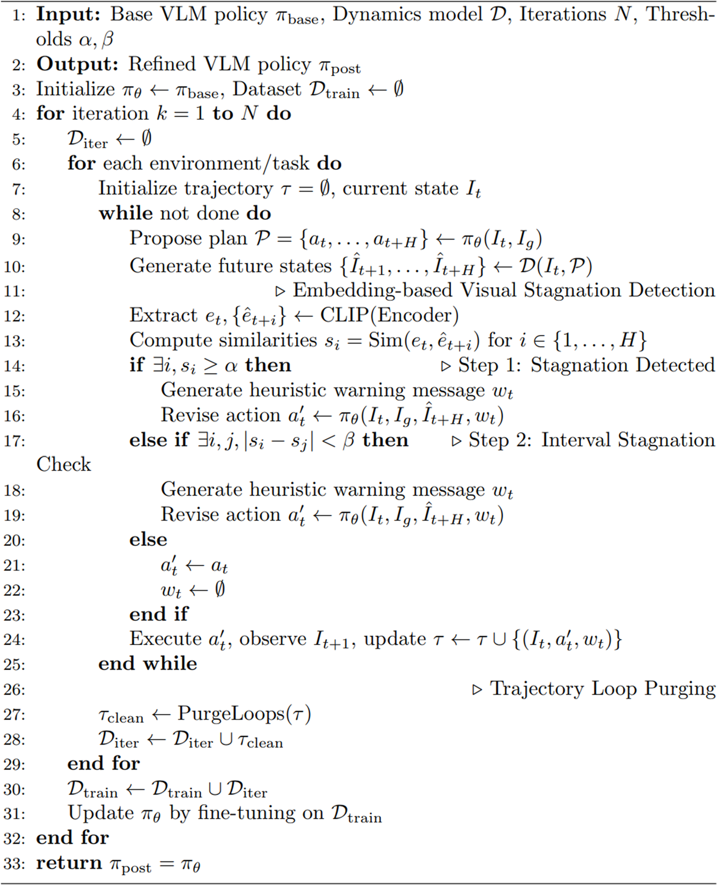
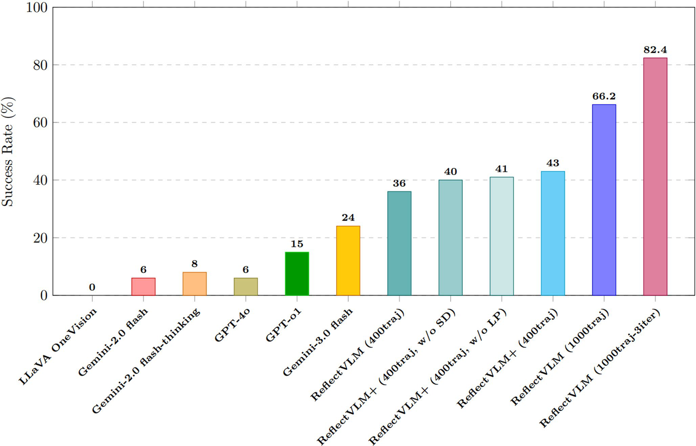

# ReflectVLM+: Enhancing VLM-based Robotic Planning via Quantitative Stagnation Detection and Trajectory Refinement

Hyeon-Sung Choi, Jong-Eun Ha*  
Seoul National University of Science and Technology

- Submitted to *International Journal of Precision Engineering and Manufacturing* (2026/02)
- Revised (2026/04) · Accepted (2026/05) · Published online (2026)

> 🚀 This project is built on **[ReflectVLM](https://github.com/yunhaif/reflect-vlm)** (Feng et al., 2025).  
> The original ReflectVLM README is kept at [`docs/README_ReflectVLM.md`](docs/README_ReflectVLM.md).

---

## Abstract

Vision-Language Models (VLMs) have emerged as a powerful paradigm for multi-stage robotic manipulation. Although recent frameworks like ReflectVLM introduce visual reflection via dynamics models, they often suffer from *logical stagnation*: repeatedly executing failed actions because they cannot perceive subtle physical blocks. This paper proposes **ReflectVLM+**, a framework that integrates quantitative stagnation detection and data refinement to overcome these limitations. First, we introduce an embedding-based **Visual Stagnation Detection** module using CLIP, which lets the model assess visual progress numerically and trigger proactive replanning. Second, we propose a **Trajectory Loop Purging** algorithm that identifies and removes inverse action pairs from self-training data, so the model learns only the optimal paths for task completion. Experiments show that ReflectVLM+ achieves a 7% improvement in success rate over the baseline, even under hardware-constrained settings with only 400 trajectories, and reduces average inference time by terminating redundant planning cycles early.

## Keywords

Vision-Language Models (VLM) · Robotic manipulation planning · Reflective reasoning · Visual stagnation detection · Trajectory refinement

---

## Method

  
   
  <em>Fig. 1. Embedding-based visual stagnation detection. The current state and the imagined future states (from the dynamics model) are embedded by the CLIP vision tower; cosine similarity decides whether the proposed plan makes visual progress, and a warning prompt is injected into the reflection loop when it does not.</em>

  
   
  <em>Fig. 2. Trajectory Loop Purging. Inverse action pairs on the same object (pick up → put down / insert, or put down / insert → pick up) are removed from collected trajectories before self-training.</em>

  
   
  <em>Algorithm 1. Reflective post-training with multi-stage trajectory refinement.</em>

---

## Results

All models are post-trained on the same 400 trajectories and evaluated on 100 procedurally generated test boards. ReflectVLM+ was trained on a single 24 GB GPU, so its batch size is smaller than the original (see Table 3). SD = Visual Stagnation Detection, LP = Trajectory Loop Purging.

**Table 1. Task performance and ablation**

| Method | Success Rate ↑ (%) | Total Steps ↓ | Avg. Steps ↓ (per traj.) | Avg. Inf. Time ↓ (s/step) |
|---|---:|---:|---:|---:|
| ReflectVLM (baseline) | 36.0 | 3,687 | 36.87 | 27.73 |
| ReflectVLM+ w/o SD | 40.0 | 3,233 | 32.33 | 27.13 |
| ReflectVLM+ w/o LP | 41.0 | 3,506 | 35.06 | 27.79 |
| **ReflectVLM+ (Ours)** | **43.0** | 3,333 | 33.33 | **26.03** |

  
   
  <em>Fig. 3. Success rate across baselines and the proposed configurations (commercial VLM numbers are quoted from the original ReflectVLM paper).</em>

**Table 2. Detection frequency and data reduction during post-training**

| Metric | Value | Remarks |
|---|---:|---|
| Total trajectories | 400 | ID 0–399 |
| Total visual warnings | 5,124 | 12.8 per trajectory |
| Total purged loops | 1,068 | 2.67 per trajectory |
| Total steps saved | 2,136 | – |
| Data reduction rate | ≈ 23.4% | redundant data removed |

**Table 3. Training configuration**

| Method | Resolution | LoRA Rank | Epoch | Batch | Optimizer | Warmup | LR | WD | Schedule |
|---|---|---|---|---|---|---|---|---|---|
| ReflectVLM | 336px | 128 | 1 | 128 | AdamW | 0.03 | 1e-5 | 0.0 | Cosine |
| ReflectVLM+ (Ours) | 336px | 128 | 1 | 16 | AdamW | 0.03 | 1e-5 | 0.0 | Cosine |

**Summary.** With the same 400 trajectories, ReflectVLM+ raises the success rate from 36% to 43% and lowers inference time per step, showing that quantitative reflection and rigorous data pruning help ground high-level VLM reasoning into precise physical execution.
